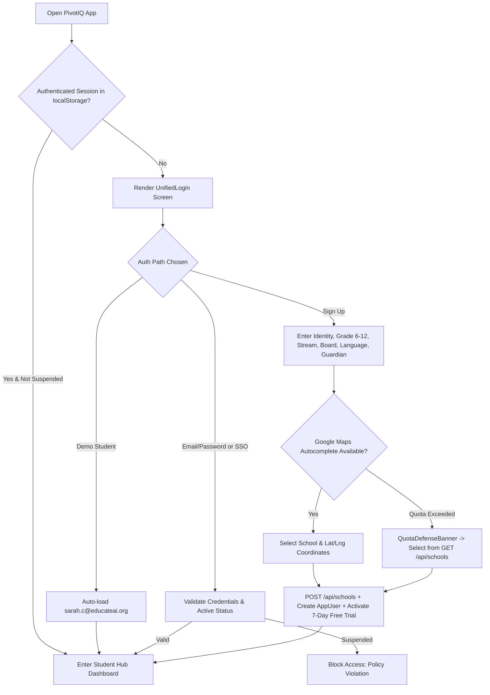
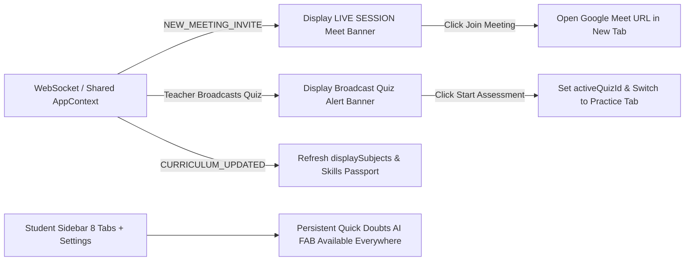
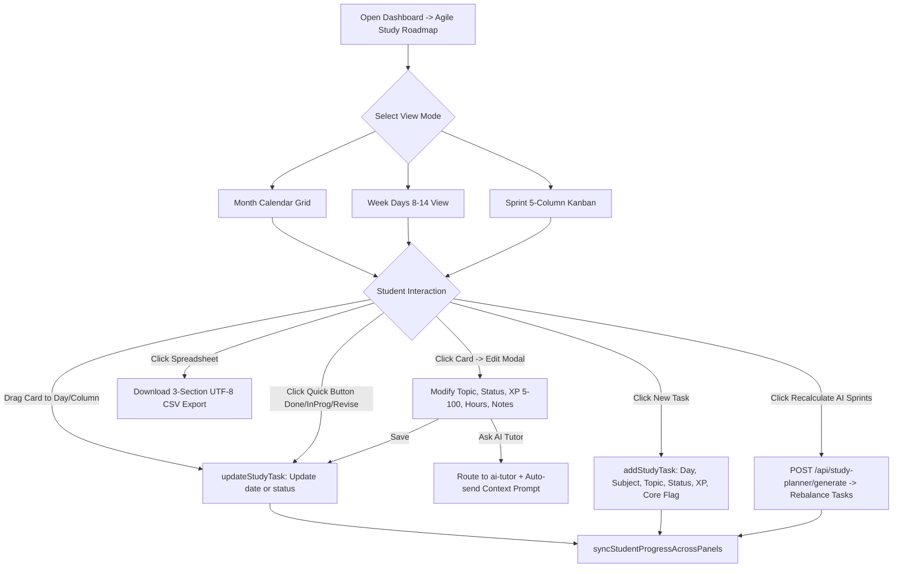
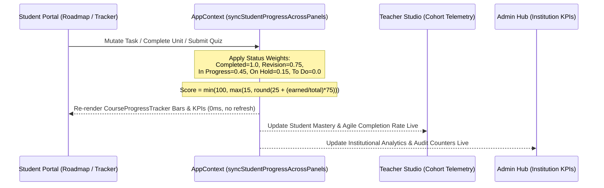
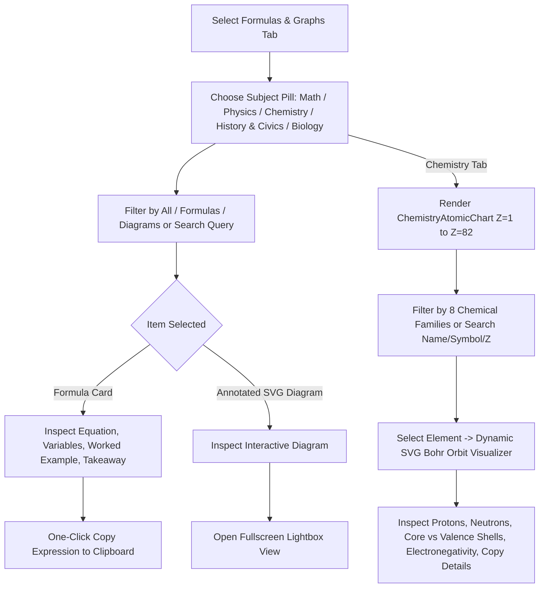
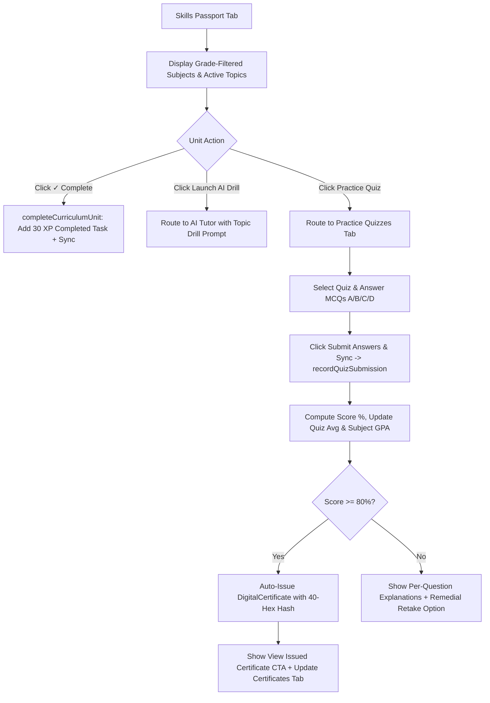
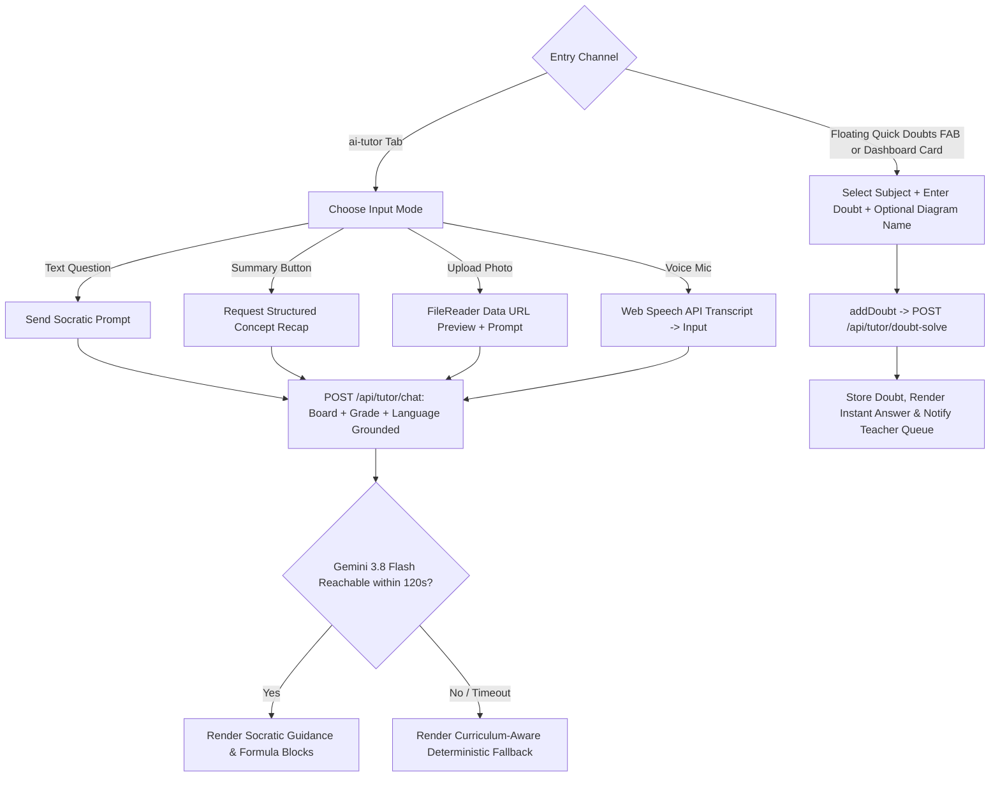
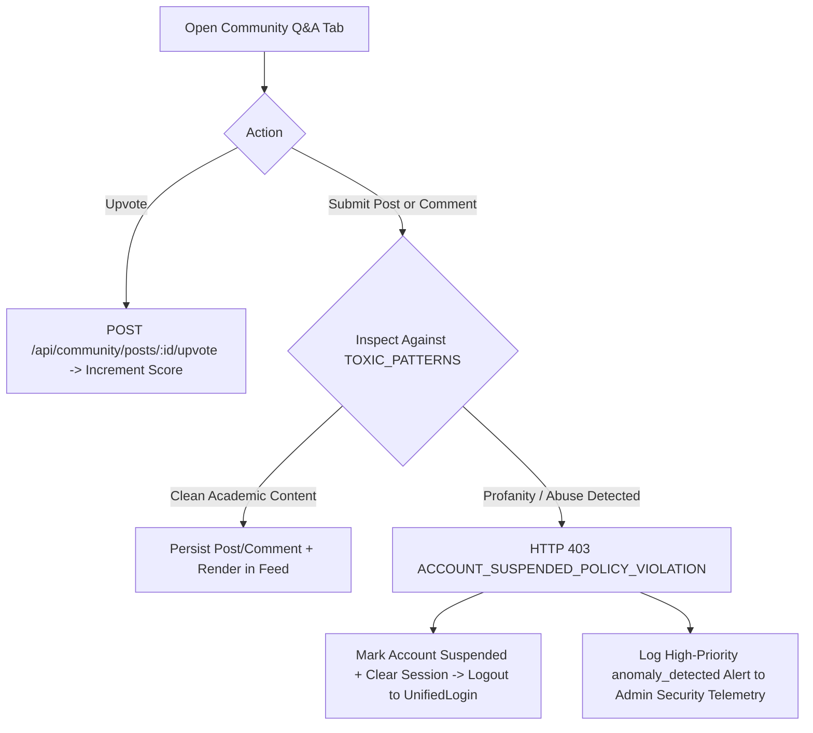
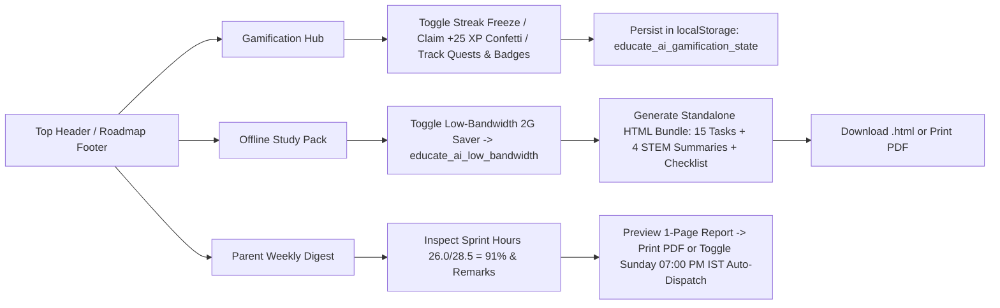

# PivotIQ Student Portal — End-to-End Workflows

**Scope:** Student Portal (`PivotIQ Student Hub`) Only  
**Notation:** Mermaid Flowcharts + Step-by-Step Operational Rules  

---

## Workflow 1: Student Portal Entry, Authentication & Onboarding

### Process Diagram

### Step-by-Step Flow
1. `App.tsx` checks `isAuthenticated` and `currentUser` (`educate_ai_current_user`).
2. Unauthenticated users land on `UnifiedLogin.tsx` with four paths: Email/Password Sign-In, Social SSO (Google/Outlook/Apple), Quick Demo Student (`sarah.c@educateai.org`), or Full Sign-Up.
3. During Sign-Up, the student specifies Grade (`6`–`12`), Stream, Governing Board (`11` choices), Language Medium (`10` choices), Guardian details, and Institutional School.
4. If Google Maps quota triggers `gmp-quota-exceeded`, `QuotaDefenseBanner` automatically switches school selection to cached records from `GET /api/schools`.
5. Completing signup registers/links the school (`POST /api/schools`), activates the 7-Day Free Trial, binds global `currentBoard` and `globalLanguage`, and opens the Student Hub.

---

## Workflow 2: Student Shell Navigation & Live Teacher Intervention Handling

### Process Diagram

### Step-by-Step Flow
1. The Student Shell maintains persistent WebSocket connectivity (`ws` on port `3000`) and shared `AppContext` subscriptions across all 9 views.
2. When an instructor schedules/starts a class, `NEW_MEETING_INVITE` renders the dismissible `LIVE SESSION` banner above the main workspace with a `Join Meeting` link.
3. When an instructor publishes a live quiz, `activeBroadcastQuiz` renders a top banner with a `Start Assessment` button that binds `activeQuizId` and switches directly to `practice`.
4. Clicking the top header profile avatar or `My Account` opens `UserProfileModal`, allowing instant updates to Grade, Board, Language, Guardian info, Password, or Avatar (26 DiceBear presets + custom upload).

---

## Workflow 3: Agile Study Roadmap, Drag-and-Drop & AI Sprint Recalculation

### Process Diagram

### Step-by-Step Flow
1. Student views planned tasks in Month, Week (Days 8–14), or 5-column Sprint Kanban (`To Do`, `In Progress`, `On Hold`, `Revision`, `Completed`), optionally filtered by status pills.
2. Student reschedules tasks via drag-and-drop across calendar days (including overflow cells) or transitions statuses via Kanban drag-and-drop / inline quick buttons (`✓ Done`, `▶ In Prog`, `↺ Revise`).
3. Opening any task displays the Edit Modal with XP (`5–100`), duration (`0.5–6h`), revision notes, and a direct `Ask AI Tutor ->` shortcut.
4. Clicking `Recalculate AI Sprints` invokes `POST /api/study-planner/generate` to re-sequence workload automatically.
5. Every task mutation immediately triggers `syncStudentProgressAcrossPanels` (see Workflow 4).

---

## Workflow 4: Reactive Progress Calculation & Real-Time Cross-Panel Sync

### Process Diagram

### Step-by-Step Flow
1. Any task status change, point adjustment, task creation/deletion, or unit completion updates `dailyTasks`.
2. `CourseProgressTracker` and `syncStudentProgressAcrossPanels` compute weighted earned points per subject (`Completed=1.0`, `Revision=0.75`, `In Progress=0.45`, `On Hold=0.15`, `To Do=0.0`) multiplied by `task.points ?? 25`.
3. Subject mastery is clamped to `[15, 100]` using `round(25 + (earned / total) * 75)`.
4. `studentsList` and `currentUser` update in shared `AppContext` memory and `localStorage`, ensuring Teacher and Admin dashboards reflect the exact updated percentages immediately with zero page reload.

---

## Workflow 5: Formulas, Board Diagrams & Interactive Chemistry Bohr Simulator

### Process Diagram

### Step-by-Step Flow
1. Student selects one of 5 subject pills and filters by view mode (`All`, `Formulas`, `Diagrams`) or keyword search.
2. Student studies any of the **16 Master Formulas** with worked examples and copies notation to clipboard, or opens any of the **5 Annotated SVG Diagrams** in fullscreen mode.
3. Selecting **Chemistry** embeds `ChemistryAtomicChart`, allowing the student to browse elements **$Z=1$ to $Z=82$**, filter across 8 chemical categories, click any element to inspect its live concentric Bohr orbit diagram (nucleus $p^+ / n^0$ + valence highlight), and copy atomic specifications.

---

## Workflow 6: Skills Passport, Practice Quizzes & Automated Certification (`>= 80%`)

### Process Diagram

### Step-by-Step Flow
1. In `my-courses`, the student reviews subjects filtered dynamically by `activeGradeFilter` (or opens `CurriculumExplorerModal` for Grades 6–12).
2. Marking a unit `✓ Complete` logs a completed `30 XP` task and recalculates mastery across all panels.
3. Launching a quiz in `practice` opens the interactive MCQ runner. Submitting calls `recordQuizSubmission`, which grades responses, updates quiz statistics, recalculates student GPA/mastery, and persists to `localStorage`.
4. Whenever `score >= 80%`, the system automatically mints a verified `DigitalCertificate` (`EDU-AI-{YEAR}-{5digit}`) with a 40-character hex hash and surfaces it immediately in both the quiz result view and the `certificates` tab.

---

## Workflow 7: Socratic 24/7 AI Tutor & Floating Quick Doubts AI

### Process Diagram

### Step-by-Step Flow
1. Student accesses `ai-tutor` directly or jumps contextually from Course Progress (`Practice AI Drill`), Agile Roadmap (`Ask AI Tutor`), Skills Passport (`Launch AI Drill`), or Grades (`Start Targeted Practice`).
2. Student interacts via text, `Summary` shortcut, homework image upload (`FileReader`), or Web Speech voice input.
3. `POST /api/tutor/chat` injects `{currentBoard}`, `Grade {studentGradeLevel}`, and `{globalLanguage}` into `gemini-3.8-flash` (`ThinkingLevel.LOW`, 120s `undici` timeout), falling back cleanly to a deterministic Socratic response if unavailable.
4. From any screen, the student can alternatively open the bottom-right **Quick Doubts AI** popover, attach a diagram filename, and trigger `POST /api/tutor/doubt-solve`.

---

## Workflow 8: Community Q&A & Zero-Tolerance Automated Moderation

### Process Diagram

### Step-by-Step Flow
1. Students browse Q&As, review **Teacher-Verified Solutions**, upvote helpful questions, and post new questions or replies.
2. Every submitted post or comment is scanned against `TOXIC_PATTERNS` both client-side and on `server.ts`.
3. Clean submissions save and broadcast to the feed immediately; any policy violation returns HTTP `403`, suspends the student account, forces immediate logout, and dispatches a security alert to Admin telemetry.

---

## Workflow 9: Gamification, Offline Study Pack & Parent Weekly Digest

### Process Diagram

### Step-by-Step Flow
1. **Gamification Hub:** Tracks daily streaks, Streak Freeze safeguard, `+25 XP` bonus claims with confetti, daily quests, Emerald League standing, and 6 achievement badges in `localStorage`.
2. **Offline Study Pack:** Enables 2G Low-Bandwidth mode (`educate_ai_low_bandwidth`) and exports a portable, self-contained `.html` revision pack (15 daily tasks, 4 STEM summaries, exam checklist) or prints to PDF.
3. **Parent Weekly Digest:** Summarizes weekly sprint completion (`91%`), displays a 1-page printable parent report, and configures automated Sunday 07:00 PM IST guardian delivery or simulated immediate test dispatch.
